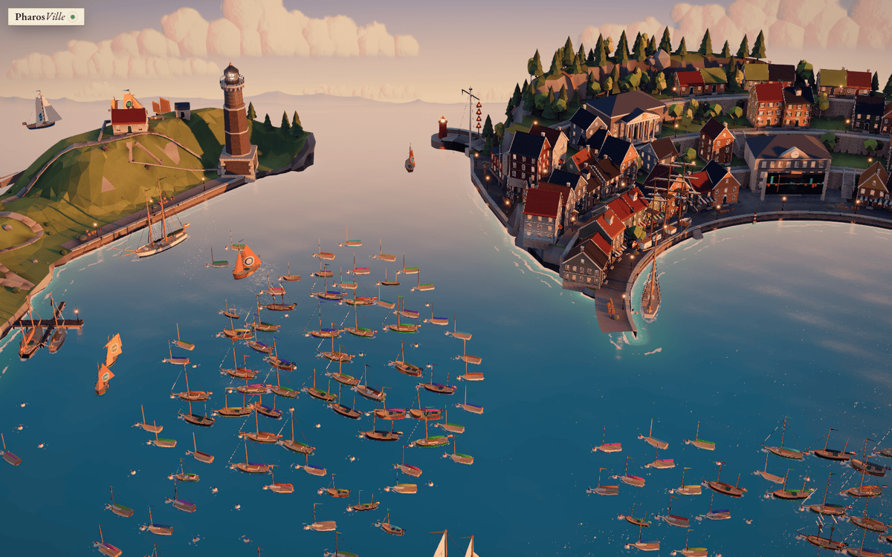

# PharosVille

[](https://github.com/TokenBrice/pharosville/actions/workflows/deploy-cloudflare.yml)
[](https://github.com/TokenBrice/pharosville/actions/workflows/canary-smoke.yml)
[](https://github.com/TokenBrice/pharosville/actions/workflows/codeql.yml)
[](./LICENSE)

PharosVille turns live Pharos stablecoin signals into a desktop-only maritime observatory built with React, Three.js, TypeScript, Vite, and Cloudflare Pages.

[Open PharosVille](https://pharosville.pharos.watch/) | [Changelog](./CHANGELOG.md) | [Roadmap](./ROADMAP.md) | [Architecture](./docs/pharosville/ARCHITECTURE.md) | [Contributing](./CONTRIBUTING.md) | [Security](./SECURITY.md)




## What It Shows

PharosVille renders a living maritime observatory of Pharos stablecoin market signals:

- stablecoin supply, presence, and identity as ships
- chain presence as harbors and docks
- risk/status water zones around the island
- detail panels and an accessibility ledger that mirror world semantics
- a full instanced fleet, stablecoin and chain identity, region-aware shader
  water, a checked GLB lighthouse, and checked hero hulls

The app is intentionally desktop-only. Screens too small to chart, and windows too small to chart, must not mount the world runtime or fetch world data; they show a fallback or rotate prompt instead. The window test is a size test, not an orientation test — a tall desktop window is not a phone.

## Trust Boundaries

PharosVille is an interpretive data visualization, not financial advice.

It does not provide:

- wallet connection
- trading
- custody
- user accounts
- browser-exposed API credentials

The browser calls same-origin `/api/*` paths only. `functions/api/[[path]].ts` proxies the allowlisted PharosVille read endpoints to `PHAROS_API_BASE` and injects `PHAROS_API_KEY` server-side. Never expose `PHAROS_API_KEY` as `VITE_*`, static JavaScript, HTML, query strings, logs, docs, or fixtures.

## Architecture

At a high level:

1. A tiny same-origin bootstrap checks the screen and window before importing React or the world; unsupported viewports keep the welcome page and request no live feeds.
2. The browser requests same-origin `/api/*` endpoints.
3. Cloudflare Pages Functions proxy only the allowed PharosVille read paths.
4. `src/harbour/` turns that data into The Harbour: a three.js WebGL2 world where every stablecoin is a boat sailing between chain harbours in proportion to its supply, the lighthouse beam is the Stability Index, and sea, weather and fog carry peg, stress and staleness.
5. `src/harbour/app/` mounts the Engine, its world systems and the chart-paper UI from a lazily loaded chunk; a poster paints first and crossfades only after the reveal policy has a rendered world or complete fleet revision.
6. A generated asset registry maps runtime media, fonts and shell CSS to content-hashed immutable paths; lossless Brotli packs reduce geometry requests. Production retains the current and preceding release's assets for old tabs and supported rollback.
7. Runtime media stays same-origin; if WebGL2 cannot start, the poster stays up with the guide and Pharos links. Slow fresh data may reveal an empty harbour before the complete fleet arrives; an unavailable fleet is never replaced with invented boats.

For the full implementation map, see [Architecture](./docs/pharosville/ARCHITECTURE.md).

## Repo Map

- `src/` - PharosVille React shell and viewport gate; `src/harbour/` is the Harbour world (engine, systems, data, UI)
- `shared/` - runtime-neutral PharosVille API contract and data logic
- `functions/` - Cloudflare Pages Function proxy and server-side response hardening
- `public/harbour/` - checked runtime GLBs, the boat kit, the sea mask, the emblem atlas and the first-paint poster
- `docs/pharosville/` - architecture, testing, operations, visual, and asset-maintenance docs
- `.github/workflows/` - deploy, canary, CodeQL, and dependency/security automation
- `agents/` - active planning and handoff artifacts
- `outputs/` - scratch screenshots, renders, and generated test artifacts

## Local Development

Use Node 24:

```bash
npm ci
npm run onboard:agent
npm run dev
```

The maintained local dev server is `http://localhost:5173/`.

`npm run dev` proxies same-origin `/api/*` through `functions/api/[[path]].ts`, which requires `PHAROS_API_KEY` server-side. The dev proxy resolves `PHAROS_API_KEY` in this order:

1. `process.env.PHAROS_API_KEY`
2. `.env.local` in the current worktree
3. `.env.local` in the main worktree, auto-discovered for linked worktrees
4. `.git/pharosville.env.local`, shared across worktrees

Initialize or update the shared key file:

```bash
npm run setup:local-api-key
```

Smoke the allowlisted Pharos endpoints before debugging missing local data:

```bash
npm run smoke:api-local
npm run smoke:dev-proxy
```

## Validation

Use the smallest relevant check while iterating:

```bash
npm run validate:changed
```

Common focused checks:

```bash
npm run validate:docs
npm run typecheck
npm test
npm run check:runtime-media
npm run build
npm run test:visual
```

Before release-level confidence:

```bash
npm run validate:release
```

For deployed changes:

```bash
npm run smoke:live -- --url https://pharosville.pharos.watch
```

## Operations

Cloudflare Pages project: `pharosville`

Required Pages setup:

```bash
wrangler pages project create pharosville --production-branch main
wrangler pages secret put PHAROS_API_KEY --project-name pharosville
```

`PHAROS_API_BASE` is set in `wrangler.toml` as `https://api.pharos.watch`.

For deployment, smoke, rollback, and credential rotation, see [Operations](./docs/pharosville/OPERATIONS.md).

## Community

- Report bugs and visual/data issues with the GitHub issue forms.
- Read [CONTRIBUTING.md](./CONTRIBUTING.md) before opening a pull request.
- Report vulnerabilities privately through the guidance in [SECURITY.md](./SECURITY.md).
- Use [SUPPORT.md](./SUPPORT.md) for support scope and triage expectations.

## License

MIT. See [LICENSE](./LICENSE).
