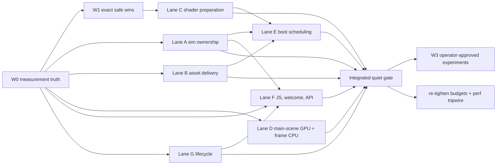

# Need for Speed — PharosVille edition: implementation plan

Status: **research complete, nothing implemented.** Base: `main` @ b71dd282 (v1.2.1). Written 2026-10-19, revised
after two final audits (`p3/audit-coverage.md`, `p3/audit-plan.md`).
Evidence: 18 slice reports (`p1/`), the consolidated register (`p2/REGISTER.md`, 120 entries `NFS-001…120`,
178/178 source findings mapped), five verification spikes (`p2/sp-{simrace,hitch,island,igpu,frag}.md`, patches in
`outputs/need-for-speed/sp-*/spike.patch`), two adversarial reviews (`p2/review-load.md`, `p2/review-runtime.md`).
IDs below are register IDs; `RR-xx`, `REVIEW-LOAD-xx` and `SP-FRAG-xx` are review/spike findings not yet in the
register. All 120 register IDs have an explicit disposition below; a few are deliberately split across waves
(NFS-004 ownership vs offline bake, NFS-086 exact reuse vs cadence, NFS-088 hoist vs half-res, NFS-097 controller vs
sub-1 floor, NFS-098 atlas split vs codec).

The rule for the whole plan: **the scenery is the product.** Every change lands only with the verification protocol
in §5 passing; anything that changes pixels or motion is in W3 and needs the operator's approval.

## 1. Baseline (measured)

| Metric | Today | Source |
|---|---:|---|
| Cold first fleet frame, fast4g (9 Mbps/40 ms), live site | 5,944 ms (n=3; quiet local A/B 5,799 ms, n=5) | `p1/load.md`, `p2/sp-frag.md` §4 |
| Cold first fleet frame, unthrottled / fast4g + 4× CPU | 2,974 ms / 9,973 ms | `p1/load.md` |
| Poster fully removed after first fleet frame | +1.26 s (1.1 s CSS fade) | `p1/load.md` |
| Immediate repeat visit, first fleet frame | 2,740–2,956 ms despite 106–176 KB on the wire | `p1/load.md` |
| Cold wire bytes / requests | 7.82 MB / 151 | `p1/load.md` |
| Blocked (welcome) viewport | 75 KB of entry + React for a page that renders no world | `p1/firstpaint.md` |
| Steady GPU, RTX 5070 Ti, DPR1 | ~1.4–1.6 ms; vsync-bound, plenty of headroom | `p2/sp-igpu.md` |
| Steady GPU, Raphael iGPU (2-CU stress floor), DPR1 | 45–54 ms; main scene 76–83% (island ≈12, ocean ≈14, fleet ≈4, civic ≈4) | `p2/sp-igpu.md` |
| Quality-tier change on iGPU (Medium→Low) | 23 new programs, **4.4 s** frozen frame | `p2/sp-hitch.md` |
| Programs at first render | 97 (63 if compiled against the composer target) | `p1/gpuinit.md` |

All timings except the quiet interleaved load A/B in `sp-frag.md` were taken on a shared machine (~18 agents) and are
labelled contended in their reports. Raphael is a weak 2-CU iGPU paired with a fast desktop CPU: a stress floor, not
a typical laptop.

## 2. Where the time goes

**Cold load is bandwidth-bound, then CPU-bound.** On fast4g the first fleet frame waits on the geometry frontier:
`island.glb.gz` (2.56 MB, ends ~4.3 s) and the island→66 kit/civic GLB fan-out (ends ~5.4 s). Calibrated model:
`5.425 s ≈ 0.15 s + 5.8 MB ÷ 1.1 MB/s`, then ~0.5 s of commit/update/render (`review-load.md` §Critical path). CPU work
(sim planning, sea decode, island merge) mostly hides under the island download on a fast desktop, but it breaks
out in two cases: (a) the **sim adoption race** — when the worker plan loses, a synchronous fallback runs inside the
first frame (`u:data` up to 2.3–6.9 s in tails; `sp-simrace.md`), and (b) slow CPUs (4× throttle ≈ 10 s).

**Repeat visits are CPU-bound.** About 2.7–3.0 s with almost no bytes: JS evaluation, plan building, scene
construction, compile/upload, plus 10–11 revalidation 304s because `/harbour/*` media is only 60 s fresh and not
content-hashed.

**Runtime: the desktop GPU is not the customer.** RTX frames cost ~1.5 ms. The customers are iGPU laptops, DPR2
retina laptops (inferred, not yet measured) and *everyone* hit by **multi-second shader-link hitches** on tier,
weather and late-material transitions. On the iGPU the cost is main-scene fragment work — procedural kit pattern
shading (≈5.3 ms knockout ceiling), overdraw on the island/civic (a depth prepass recovered ≈5.6–5.9 ms with
identical pixels in the tested views) and the ocean — not post-processing (bloom ≈1.3–1.5 ms in total). The prepass
and pattern savings overlap; do not add them.

## 3. Targets

Load rows are **modeled forecasts** (`review-load.md` §T1+T2). GPU and transition rows are **proposed acceptance
goals**, not outcomes the exact tranche is shown to reach. Report residual gaps after the integrated measurement; never
add knockout ceilings to prepass savings or slip in an unapproved scenery change to hit a number.

The operator declined the lossy geometry and faster fade (§6 W3), so the old "with W3" load column is gone; the
approved W3 trials do not change the healthy-path forecast.

| Audience | Today | After W1+W2 (no visual change) |
|---|---:|---:|
| Cold fast4g first fleet frame | 5.9 s | modeled **~5.0 s** (4.7–5.2) |
| Cold fast4g poster fully removed | 7.2 s | modeled ~6.2 s (5.85–6.45), unchanged 1.1 s fade |
| Repeat-visit first fleet frame | 2.7–3.0 s | modeled 2.2–3.0 s envelope |
| Blocked welcome page | 75 KB entry + React | no React/world/API bytes (tiny bootstrap remains) |
| Raphael iGPU (low-end stand-in), heart noon, DPR1 | ~45 ms | goal p50 ≤33 ms (not forecast as achieved) |
| MacBook Pro M5 Max, native retina (DPR2), heart noon | unmeasured | goal: steady 60 Hz (or display rate) at native DPR2 with no quality downshift; baseline taken in W0 with a thermal plateau |
| Tier/weather/selection transitions | up to 4.4 s freeze | goal: no unprepared program activation for covered states; no attributable visible task >50 ms, verified with and without KHR_parallel_shader_compile |
| RTX desktop | 60 Hz, ~1.5 ms | unchanged pixels and pacing; never regress |

The only laptop available is a high-end M5 Max: it covers the retina/DPR2 and Safari/Apple-GPU paths, not typical
laptops. The Raphael iGPU remains the stand-in for ordinary integrated graphics; no "typical laptop" number is claimed.
Do not promise sub-4 s cold fast4g from current evidence.

## 4. Constraints (from `p1/priorart.md`)

No renderer switch or graphical fallback; no WebGPU. No change to what the world means (data mappings, D1–D14,
fog = stale data, unknown stays unavailable). Desktop gate: blocked viewports load no world, three.js, GLBs or API.
CSP unchanged (`wasm-unsafe-eval` is not worker authorization; workers stay same-origin). `check:harbour-contracts`
GLB node names; `check:runtime-media` inventory; bundle budgets re-tightened after each diet (`PA-05`). Byte-identical
sim routes (parity tests). Looks and frame time judged only through `npm run preview` (real GPU). Releases only via
`.github/workflows/release.yml`.

## 5. Verification protocol (applies to every change)

1. **Still equivalence.** Deterministic golden capture: pinned clock, reduced motion, fixed engine/weather elapsed,
   zero-delta manual renders, forced shadow refresh (controls in the `sp-igpu` patch). Private clocks (ocean
   `MotionClock`, eased uniforms) must converge too — `sp-island`'s noon goldens diverged without it (REVIEW-LOAD-04).
   Views: heart, overview, closest zoom × noon, golden hour, night × summer, winter (incl. a live leaf↔bare
   transition) × calm, storm; DPR1 and DPR2. Noise floor SSIM ≈0.9995 / MAE 0.06. Numbers screen; a human LOOKS at
   every pair.
2. **Temporal and semantic equivalence.** Stills are necessary, not sufficient. Every arrival, lazy-loading, culling,
   cache, rope, readiness or state-publication change also needs matched normal-motion filmstrips and assertions for
   its path: camera pan/zoom and offscreen reentry; offscreen shadow/wake/light contributions; close-up moving ropes;
   refresh with changed IDs; held-motion caches with continued lookahead and freshness bookkeeping; first
   selection/search/ledger; slow or failed imports; pending, failed and valid zero-boat data; admission
   denial/readmission. Compare what is visible *during* arrival (yard, boards, people, labels), not only the settled
   world.
3. **Load.** Quiet machine, production-faithful origin (`outputs/need-for-speed/load/server.mjs` pattern: `dist` +
   `_headers` + real `/api` function), interleaved A/B, n≥5 cold fast4g, n≥3 unthrottled, 4× CPU and iGPU arms;
   report first fleet frame, crossfade start and poster removal separately. Transport and caching are confirmed on
   the live CDN (no local equivalent of Pages compression/caching).
4. **Frame and resources.** iGPU and RTX, per-pass GPU timers (profiler in the `sp-igpu` patch), completed-query
   distributions, p10/p50/p95 and real elapsed pacing, steady window with zero program creation; transitions measured
   by max frame. Record CSS size, display and effective DPR, tier, browser/driver, thermal/battery state. Run pinned
   DPR1, native DPR2, an adaptive-governor transition lane and a timer-unavailable lane, with a sustained thermal
   plateau on the MacBook Pro M5 Max. Inventory logical render-target/texture/geometry/program bytes separately from
   observed memory and boot/resize/prewarm peaks (old+new targets, pack/decode buffers, worker copies, canvases);
   check context loss and post-disposal plateaus.
5. **Correctness.** `npx vitest run src/harbour`, sim parity tests, `npm run check:viewport-gate`,
   `npm run check:harbour-contracts`, `npm run check:runtime-media`, `npm run validate:changed`.

## 6. Waves

### W0 — Measurement truth (prerequisite; tooling only, no runtime change)

Without this, wins cannot be attributed and regressions cannot be caught. Reuse `shot.mjs` and the shared lock; no
second browser system.

| ID | Work | Notes |
|---|---|---|
| NFS-105, NFS-114, RR-04, NFS-071 (query ring only) | Fail hard when the engine is not ready; real elapsed frame pacing (not nominal fps); honest GPU samples (completed, frame/state-tagged queries in a reusable ring, not the latest value); stream large traces | keep the governor's >20-sample decision rule; `p1/frame.md` FRAME-06, `p1/gates.md` |
| NFS-106, REVIEW-LOAD-02 | Report first **fleet** frame, crossfade start and poster removal; prepared/rendered model revision, so an earlier empty frame does not read as a win | needed before Lane A |
| NFS-108, NFS-112 | Repeatable cold/repeat load benchmark on the production-faithful origin (+ live CDN transport check) | promote `outputs/need-for-speed/load/{server,run-load,run-warm}.mjs` |
| NFS-109, RR-06 | Steady matrix per §5.4: RTX + Raphael iGPU, DPR1 + DPR2, heart/overview/closest, noon/night, storm/winter; MacBook Pro M5 Max at native retina in Safari and Chrome | the M5 Max runs by hand, outside the shared capture lock |
| RR-08 | Source-isolated main-scene material/vertex/fragment sensitivity probes (extends `sp-frag` flags) | informs Lane D order |
| NFS-111, REVIEW-LOAD-04 | Deterministic still + motion-filmstrip capture and perceptual diff (§5.1–5.2) | |
| NFS-110, REVIEW-LOAD-09, NFS-046 | Static first-frame byte ledger, media-size budgets (CI-safe; no GPU in CI); preload priority/boundary audit | |
| NFS-113, NFS-116, NFS-117 | Persisted baselines; contended/quiet flag; CI-without-GPU policy (SKIP is not PASS) | |
| NFS-118 | Refresh/remount memory soak lane (incl. workers and retained pack buffers) | acceptance for Lane G |
| — | Per-pass GPU profiler from `sp-igpu` kept behind `?prof` | |

Drop NFS-115 (already correct, `review-load.md`). NFS-107 (deploy perf tripwire) is wired at the integrated gate,
once stable thresholds exist.

### W1 — Exact safe wins (identical pixels and motion)

Each item has its own invariant. Items that share files are ordered by the owners in §7, not run concurrently.

| Unit | IDs | Change | Gain (best evidence) | Files (under `src/harbour/` unless noted) |
|---|---|---|---|---|
| GPU init | NFS-014 + RR-02 | Compile against the composer input target **and** the intended initial light/quality state | 97→63 programs, 36→13 links at first render; composer −203 ms (contended) | `engine/engine.ts`, `lights/lights-system.ts` |
| GPU init | RR-01 | Stop bloom tier changes from disposing reusable mip-blur materials (rebuild targets only) | 2 avoidable relinks per tier change | `engine/post.ts` |
| GPU init | NFS-012 | Generate cloud-atlas mips once after baking | ~4.9 M redundant mip texels at boot (~1 ms GPU scale) | `sky/clouds.ts` |
| Atlases | NFS-017 | Right-size and batch the initial emblem placeholder atlas (no 42 MiB first upload, no repeated grow copies) | 105 ms upload + 79 ms grow (contended) | `fleet/emblems.ts` |
| Atlases | NFS-099 | Chart lettering as single-channel texture + lossless WebP | 4.4 MiB VRAM, 13 KB | `identity/lettering.ts`, `public/harbour/chart-lettering.*` |
| Memory | NFS-004 (ownership part) | Give the ground-bake target explicit ownership; dispose it only after every GPU consumer (lights-system pillar land mask samples it) is torn down, or first install an independently owned exact height texture for those consumers | teardown leak fix; steady saving only if the replacement is smaller (measure) | `world/ground.ts`, `world/island-system.ts`, `lights/lights-system.ts` |
| Fetch | NFS-026 | One per-engine promise per static manifest/JSON (civic ×2, kit ×3, crests ×2 today) | 4 redundant requests + parses | `engine/assets.ts`, `engine/prefetch.ts`, `fleet/hull-kit.ts`, `civic/civic-system.ts`, `civic/shipyard.ts`, `identity/identity-system.ts` |
| Shaders | NFS-080, NFS-081, NFS-085, NFS-088 (hoist), SP-FRAG-03, RR-07 | Exact sky-hill bound rejection; below-horizon early return; remove dead opposite beam sea-foot; hoist uniform fog math; dark-pool early return; no clear before the full-overwrite wake pass | sky ≈0.7–0.8 ms iGPU with identical pixels; pool ≈0.27 ms; others small | `sky/sky-glsl.ts`, `beam/`, `world/materials.ts` (pool), `readings/fog.ts`, `ocean/gpu-bake.ts`, `ocean/wake.ts` |
| Lights | NFS-087 | Skip exactly zero-output daylight glow draws (after RR-02) | 2 draws by day | `lights/lights-system.ts` |
| Frame CPU | NFS-058, NFS-059, NFS-064, NFS-065, NFS-066, NFS-067 | Cache stationary-camera sky horizon geometry; freeze audited static local transforms (never moving descendants; not a traversal elimination); cache static worker/crest placements; hoist per-frame allocations; cache walkway edges; reuse held poses under reduced motion while keeping lookahead draining | 0.3–0.7 ms sky; ≤0.2–0.4 ms transform hypothesis; smaller items | `sky/sky-system.ts`, `engine/static-merge.ts`, `civic/`, `life/`, `sim/system.ts` |
| Power | NFS-104 | Pause audio JS scheduling while hidden, on Lane G's cancellation seam | 12.3 wakeups/s per hidden sound-on tab | `audio/controller.ts`, `audio/ambience.ts` |

### W2 — Structural work (no visual change; parallel lanes, one integrated measurement)

**Lane A — Simulation ownership** (spike `sp-simrace`; patch passes parity, 2,487 exact route comparisons).
NFS-001 single-owner prepared first plan; no fallback compute inside a frame; honest awaiting state kept →
NFS-006 versioned compact layout seeds (+49 KB br on the wire; estimated 0–250 ms earlier fleet) → NFS-007
persistent/sliced planning worker for genuine replans (0.5 s boot task, 1.4–1.6 s refresh tasks off the frame) →
NFS-008 content-addressed path cache; NFS-011/NFS-044 inside the cutover; NFS-060 reconcile fleet instances by ID on
refresh; NFS-053 reveal only after a composer-completed frame of the committed model revision's complete fleet pose
(timeout and fade constants unchanged); REVIEW-LOAD-05 monotonic revision precedence so no late result overwrites
fresher data. Under the exact production CSP and emitted worker URLs, prove worker startup, result delivery and
adopted revision on every supported browser, and assert a successful render did not silently take a main-thread
fallback. Measured: first `u:data` 1,726→0 ms, first boats visible −510 ms (contended dev). Mostly a tail-latency and
reliability fix, not a 2 s median win.

**Lane B — Asset delivery** (spike `sp-island`; lossless part only).
NFS-025 content-hashed `/harbour/` media + fonts + shell CSS with immutable caching (one registry feeding HTML
preloads, manifests and loaders) → NFS-020 precompressed Brotli GLBs (today `.glb.gz` is served without
`Content-Encoding` and inflated in JS) + NFS-021 two scoped packs for the 49 eager kit and 17 civic GLBs →
REVIEW-LOAD-01 exact planar-delta sea transport (823→602 KB, zero coast/RGB difference, decode-memory gate).
NFS-028 + NFS-029 together (REVIEW-LOAD-10): move yard logo/monogram/board paint and hull-stages requests only to the
earliest point that still prepares the same visible yard content before its first draw — removing eager prefetch and
eager `buildYard` demand together; if the saving needs later visible content, it goes to W3.
Gain: 423 KB lossless (644 KB with exact sea) ≈ 0.38–0.59 s link occupancy on fast4g; repeat visits lose their
revalidation waves.
Acceptance: on supported Chrome, Firefox and Safari, assets travel the browser HTTP stack (including a browser
without JavaScript Brotli `DecompressionStream`), with no JS Brotli inflation and no double decode; verify encoding,
MIME, validators, decoded hashes and pack bounds on Pages, not only localhost. Release gate: decide the immutable
namespace and retention window first; in a two-release fixture, deploy A→B, fetch a never-fetched lazy A asset from
an A tab, then exercise a production rollback; live smoke after an actual rollback.

**Lane C — Shader preparation and transitions** (spike `sp-hitch`; after the W1 GPU-init unit).
NFS-015 warm post, private scenes and shadow-depth materials with real framebuffer state behind the poster;
NFS-016 stage bulky uploads with `renderer.initTexture` during real idle waits; NFS-018 prepare the actual next
tier/weather/late-material state before publishing it (preparation-owned materials, immediate `finally` restoration
of target/light/material state before any await, poll only preparation-owned programs, one adjacent state, bounded
and cancellable on superseding state/resize/season/disposal; the current tier keeps drawing meanwhile); RR-03
seasonal bare/leaf key transitions prepared and invalidated coherently; RR-05 skip resize fan-out when a tier change
does not change dimensions; then NFS-097 (control part) separates resolution choices from effect tiers inside the one
existing governor. Turning off shader diagnostics alone does not fix the hitch: the wait moves to program reflection.
Test KHR-present and KHR-absent separately; without KHR, compile submission is not proof of non-blocking completion —
report an unresolved transition target rather than suppress diagnostics, freeze motion or change quality to pass.

**Lane D — Main-scene GPU and frame CPU** (spikes `sp-igpu`, `sp-frag`).
SP-FRAG-01 static opaque depth prepass for island + civic: −5.6 ms noon / −5.9 ms night on iGPU, SSIM 1, MAE 0 —
proven only in the tested summer heart pairs. Define an explicit target registry of static depth contributors (account
for every renderable, exclude non-targets); each target's depth variant must match its colour pass's transforms
(batches/instances), sidedness, clipping and alpha/procedural discard including live leaf↔bare transitions; own late
attach/remove, invalidation, clear/depth order and disposal; never ship the spike's global visibility swaps.
SP-FRAG-02 exact pattern-ID-specialized kit materials (knockout ceiling ≈5.3 ms, overlapping the prepass saving;
specialization must be algebraically identical).
NFS-057 may skip only proven unobservable fleet visual work: keep authoritative simulation and current transforms
for camera and shadow contributors, picking, wake/contact stamping and exact pose on reentry; reduced-rate simulation
is not part of W2. Then NFS-062 dirty-row/ranged uploads (fender matrices, fleet data texture) on the same per-ID
invalidation contract, and NFS-063 GPU-evaluated mooring ropes.
NFS-075 spatial static batching: first replace `USE_BATCHING` as the snow-role discriminator with an explicit
moving-hull semantic (hulls keep 0.4 cover, static scenery keeps its own); keep main/shadow/ground visibility
independent. NFS-083/084 exact ocean work only if pass timing shows a gain (phase fusion measured no reliable win,
SP-FRAG-07). NFS-086 exact dirty reuse of the sky reflection band (invalidate on camera/time/weather/flash; its
cadence branch is W3). NFS-077/079 conditional depth copy and NaN-scrub fusion only where no consumer needs them (no
gain in tested views while beam/shimmer read depth). NFS-098 split the immutable logo atlas from dynamic monograms
(ownership only; codec is W3).
Frame CPU: NFS-061 cache overlay measurements (one projection context per frame, cached rects, batched reads then
writes; ~98% fewer layout reads in chart mode).

**Lane E — Boot scheduling and CPU** (after A, B and C's preparation interface; re-evaluate on the new graph).
NFS-002 separate prepare from ordered commit (the claimed 0.3–1.2 s is the least trusted number; measure what leaves
the critical frontier); NFS-005 fused dequantize+merge for island and civic (25–80 ms); NFS-003 exact identity
placement loop work first (reuse per-label glyph geometry across candidates; skip polygon tests outside an expanded
bounding box), worker only if still needed (placement measured 130–560 ms, after the first frame).

**Lane F — Initial JS, welcome page and API.**
NFS-052 tiny same-origin pre-React bootstrap: denied viewports get no React/world/API (−74 KB). Keep the useful
welcome heading/status, guide and links and both screen-incapable/window-too-small variants; reuse the sorted
720×600 physical-screen AND viewport predicates without leaking requests in screen-denied/viewport-admitted or zoom
cases (REVIEW-LOAD-07); failed imports leave an honest welcome; the admission owner restores the arrival poster for
denied→admitted→denied→readmitted (REVIEW-LOAD-06; today `poster.ts` removes it and never recreates it). Final
acceptance waits for Lane A's reveal and Lane G's teardown.
NFS-033 fix the static import in `ui/yard.ts` that defeats civic's dynamic `prelaunch.json` import (24–25 KB gzip);
NFS-032/034 lazy panels/search/ledger and cemetery prose, keeping scenery projections eager; preload these chunks
quietly right after the reveal so the first click stays instant (operator decision 9).
NFS-019 project API payloads to the full consumer contract (−83% decoded JSON; ~214 KB less compressed traffic
[estimate]; approved, §8) → NFS-024 honour conditional validators (matching ETags today still return full 200
bodies). NFS-027 lossless WebP logo library (pixel-identical; 3.25 MB library, 80 KB eager).
Load Google Analytics and the Cloudflare beacon after the world is revealed, not during arrival (operator decision 6;
visits that leave in the first seconds may be under-counted).

**Lane G — Lifecycle and memory.** NFS-101 explicit dispose ownership for engine, services, audio controller,
listeners, workers and caches (leaked controllers keep 12.3 wakeups/s and ~25 MB PCM each); one ownership contract
shared with the W1 ground-target and audio items; proven by NFS-118 soak.

### Integrated gate

After W1+W2 land: quiet interleaved cold fast4g / unthrottled / 4× CPU / iGPU load arms; repeat immediate, >60 s,
cross-deploy and rollback arms; steady matrix and resource inventory (§5.4); transition maxima with and without KHR;
full still + filmstrip set. Then re-tighten `scripts/bundle-budgets.mjs` to measured + 10% (PA-05), add media and
first-frame byte budgets, and wire NFS-107 perf tripwires with the persisted baselines.

### W3 — Experiments that change pixels or motion (operator approval each, never bundled)

**Approved for trial (2026-10-19)** — still shipped only after before/after stills and motion filmstrips are shown
and accepted:

| ID | Change | Potential gain | What to show the operator |
|---|---|---|---|
| NFS-055 | shorter pending-data hold when the API is slow (REVIEW-LOAD-08: define the deadline origin) | no gain on measured healthy/failed paths; helps slow-API visits | world without boats while data is pending, then a coherent whole-fleet arrival — no partial fleet, no decorative fog |
| NFS-036 | lazy-load already-deferred life/identity code | 22–24 KB gzip | arrival filmstrip: how much later people, gulls and sea labels appear |

**Declined by the operator (2026-10-19)** — do not implement; reopen only if the operator asks:
NFS-022/023 (lighter model encodings), NFS-054 (faster poster fade), NFS-073 (half-resolution bloom), NFS-097 sub-1
floor (lower resolution on weak GPUs), NFS-074, NFS-076, NFS-078, NFS-088 (half-res), NFS-089 (simpler sea, wake, AA,
fog, beam), NFS-086 (cadence), NFS-030/031/098 (codec) (smaller/compressed sail logos), NFS-103 (30 fps mode).
NFS-039 (persist last-good data) is declined: always wait for fresh data.

**Not yet put to the operator** (lower value; ask only with measured evidence): NFS-093/094, SP-FRAG-05 (backface
culling, authored far LOD, baked lamp spill), NFS-100 (lower-resolution visual sea channels).

### Parked (reopen only with a measured, audience-specific bottleneck)

NFS-004 offline ground bake (the ownership fix stays in W1), NFS-009/010 speculative sim caches, NFS-013 compile
hints, NFS-035 conditional weather modules, NFS-037 early stablecoins request (no measured reveal gain), NFS-038/041
custom SWR, NFS-040 Early Hints (Safari's 103 support does not include preload), NFS-042/050 edge
micro-optimizations, NFS-043 polyfill, NFS-045 meshopt decoder 1.2, NFS-047 compression dictionaries, NFS-048
service worker, NFS-049 bfcache, NFS-051 prop instancing redesign, NFS-056 inline CSS, NFS-068, NFS-069 lower-rate
distant boats, NFS-070, NFS-071 (lower query frequency), NFS-072, NFS-082, NFS-090/091, NFS-092 half-res clouds,
NFS-095 shadow proxies (Low floor), NFS-096 30 Hz shadows, NFS-102, NFS-119 OffscreenCanvas worker, NFS-120 three.js
upgrade (r186 is already the latest stable). Any eventual temporal/visual change from this list still needs W3
approval.

Ruled out with evidence: generic meshopt simplification of the island (2.15%), replacing PBR/PCF or single-siding the
kit (golden failures, SP-FRAG-04), shrinking shadows on Low (visible), ocean phase fusion (no reliable win,
SP-FRAG-07), "16 point lights" as the iGPU root cause (Low already uses 4 guarded lights), half-bloom as an 8–12 ms
win (bloom totals ≈1.3–1.5 ms). SP-FRAG-06 (the combined byte plan holds up under quiet A/B) is evidence for Lane B,
not a separate item; REVIEW-LOAD-03 is folded into NFS-014 + RR-02.

## 7. Implementation fan-out

**Owners for shared files** (one integration owner each; others go through agreed interfaces, not concurrent edits):

- **Engine owner** — `engine/engine.ts`, `engine/types.ts`, `engine/post.ts`, `engine/quality.ts`,
  `engine/governor.ts`, lights quality publication. Order: W1 target/initial-light/bloom fixes → the
  render-completed revision hook for Lane A → Lane C preparation → Lane D prepass/depth-consumer changes → Lane E
  scheduling → Lane G teardown. Keep normal and profiled frame paths coherent.
- **Material owner** — `world/materials.ts` and seasonal colour/depth contracts: W1 SP-FRAG-03 → Lane C bare/leaf
  invalidation → Lane D pattern specialization, prepass depth variants and batching snow semantics.
- **Lights owner** — `lights/lights-system.ts`: RR-02 (with the engine owner) → NFS-087 → NFS-004 consumer contract.
- **Civic/asset owner** — W1 NFS-026 → W1 civic NFS-064 → Lane F NFS-033 → Lane B demand loading → Lane E decode/commit.
- **Sim owner** — W1 NFS-067 → Lane A cutover. W1 NFS-017 precedes Lane D NFS-098.

**Dispatch.**

- W0: four deliverables — load/readiness/byte harness; completed-frame GPU/pacing harness (+ RR-08 probes);
  deterministic still + motion harness; persisted baselines/soak/CI policy. Then baselines on a quiet machine.
- W1: eleven table rows, grouped by the owners above.
- W2: after W0, Lanes A, B, D, F (API/UI parts) and G run concurrently outside the owned files; C starts after the W1
  GPU-init unit and the material/lifecycle interfaces; E after A, B and C's preparation interface; F's admission
  acceptance waits for A's reveal and G's teardown. Split lanes into tickets: A ownership/readiness → seeds → planning
  worker → cache/reconciliation; B registry/retention → packs/transport → sea decode → demand/preloads; C private-pass
  coverage → next-state ownership → seasonal/resize/governor; D prepass → specialized materials/batching and fleet
  cull → dirty uploads/ropes, conditional post work separately; E scheduler, fused decode, identity loops; F
  admission, UI split, API projection → validators; G engine/service cancellation, audio/cache disposal.
- Every ticket records ID, owner, writable files, prerequisites, exported contract and acceptance artifact; every
  ticket passes §5 for its path; no ticket claims a gain without the quiet A/B; no lane is complete before its
  cross-lane acceptance passes.

## 8. Operator decisions (settled 2026-10-19)

1. **API data:** approved — the Pages Function may trim `/api/*` responses to the fields PharosVille reads
   (NFS-019/024). Only PharosVille uses these routes.
2. **Old asset versions:** keep the last **2 releases** of fingerprinted `/harbour/` media, fonts and shell CSS
   reachable (NFS-025); the two-release rollback test in Lane B uses exactly this window.
3. **W3:** trial only NFS-055 (shorter wait when data is slow) and NFS-036 (people/gulls/labels code loaded later);
   everything else in W3 is declined (§6).
4. **Hardware:** the only laptop is a **MacBook Pro M5 Max (48 GB), retina**. It is the DPR2 / Apple-GPU / Safari
   test device. Raphael iGPU stays the low-end stand-in; goals as in §3. Memory/thermal envelopes are set from W0
   measurements on these two machines.
5. **Saved data between visits:** declined — always wait for fresh data (NFS-039 not implemented).
6. **Analytics:** load GA and the Cloudflare beacon after the world appears (Lane F).
7. **Browsers:** latest 2 versions of Chrome, Firefox, Safari and Edge. Paths without KHR_parallel_shader_compile or
   GPU timer queries must still work correctly; their transition goal is reported, not assumed.
8. **Release checks:** automatic file-size/byte budgets block releases in CI; real-GPU looks, frame-time and
   transition checks are run by hand on this machine (and the M5 Max where relevant) before each release. Missing
   hardware or contended evidence is recorded as SKIP, never PASS.
9. **Lazy panels:** allowed only with no noticeable first-click delay — preload after the reveal.

Still open (engineering, not operator): where persisted baselines and goldens live, and who holds the quiet capture
slot during implementation — settle in W0.

## 9. Evidence index

| Topic | Reports |
|---|---|
| Load baseline, critical path, local production origin | `p1/load.md`, `outputs/need-for-speed/load/` |
| Frame baseline, governor, golden notes | `p1/frame.md`, `p2/sp-igpu.md` |
| Assets | `p1/glb.md`, `p1/media.md`, `p2/sp-island.md` |
| JS, first paint | `p1/bundle.md`, `p1/firstpaint.md` |
| Boot, sim | `p1/boot.md`, `p1/datasim.md`, `p2/sp-simrace.md` |
| GPU init, hitches | `p1/gpuinit.md`, `p2/sp-hitch.md` |
| Runtime GPU | `p1/pipeline.md`, `p1/shaders.md`, `p1/scene.md`, `p2/sp-igpu.md`, `p2/sp-frag.md` |
| Runtime CPU, lifecycle | `p1/actors.md`, `p1/loop.md` |
| Edge, caching, API | `p1/edge.md`, `p1/external.md` |
| History, constraints, tooling | `p1/priorart.md`, `p1/gates.md` |
| Consolidation, review, audits | `p2/REGISTER.md`, `p2/review-load.md`, `p2/review-runtime.md`, `p3/audit-coverage.md`, `p3/audit-plan.md` |
